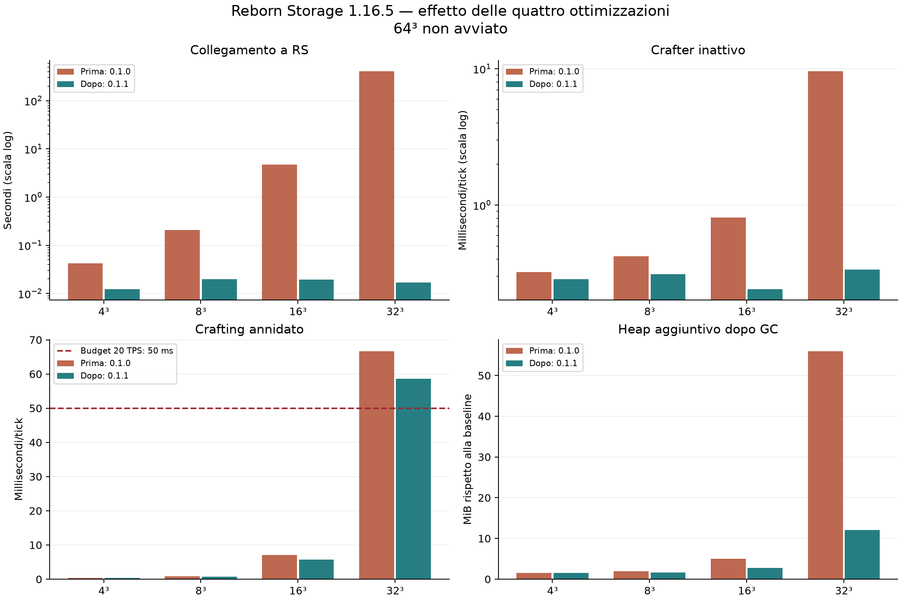

# Quattro ottimizzazioni del crafter — confronto 0.1.0 / 0.1.1

Produzione prima: **5d8d619**. Dopo: **264b5e4** (implementazione **b1b8221**). Stessi carichi semplici e annidati, tre finestre consecutive ciascuno, JVM nuove per dimensione. Il 64³ non è stato avviato. [Metodo e riproduzione](METHOD.md).

## Cosa cambia

1. Invalidazioni di grafo e pattern deduplicate per rete/provider e scaricate a fine tick server, dopo gli aggiornamenti dei mondi. I container con pattern in attesa di aggiornamento sospendono il crafting fino al rinnovo della cache.
2. Solo gli storage conservano inventari persistenti da 78 slot. Cornici, dissipatori e CPU non creano nodi RS o inventari; i vecchi record strutturali vuoti vengono rimossi quando si caricano i blocchi.
3. Conteggi CPU, consumo, inventario aggregato e porte esterne vengono aggiornati ai cambiamenti strutturali/configurativi. Nessun polling dei pattern o marcatura dei chunk come modificati a ogni tick.
4. Un unico provider RS rappresenta il multiblocco completo ed espone tutte le superfici. Gli storage mantengono un adattatore inerte per leggere i task salvati da RS: non compaiono nel grafo e non aggiungono budget di crafting.

Consumo FE e budget CPU restano quelli configurati. Le copie dello stesso pattern negli storage non moltiplicano più il numero di provider. Una struttura smontata non conduce la rete come se fosse una catena di cavi. Nessuna modifica interna a RS e nessun budget temporale globale.

## Collegamento e dimensione del grafo

| Crafter | CPU | Nodi della rete prima → dopo | Collegamento RS, secondi prima → dopo |
| --- | ---: | ---: | ---: |
| 4³ | 7 | 66 → 3 | 0,042 → 0,012 |
| 8³ | 215 | 514 → 3 | 0,207 → 0,020 |
| 16³ | 2.743 | 4.098 → 3 | 4,686 → 0,019 |
| 32³ | 26.999 | 32.770 → 3 | 403,650 → 0,017 |

I tre nodi della rete nuova sono controller, disk drive e provider aggregato. Nel registro persistente restano due record: disk drive e inventario dello storage. Il multiblocco è fisicamente pieno in entrambe le versioni.

## Tempi e TPS

Tempi del tick completo in millisecondi, espressi **prima → dopo**. Il budget per 20 TPS è 50 ms. Le medie sono aggregate sui campioni delle tre finestre.

| Crafter | Inattivo ms | Semplice ms | Annidato ms | Annidato P95 ms | TPS annidato |
| --- | ---: | ---: | ---: | ---: | ---: |
| 4³ | 0,32 → 0,29 | 0,42 → 0,28 | 0,39 → 0,32 | 0,52 → 0,45 | 20,00 → 20,00 |
| 8³ | 0,42 → 0,31 | 0,66 → 0,43 | 0,83 → 0,68 | 1,23 → 1,00 | 20,00 → 20,00 |
| 16³ | 0,81 → 0,24 | 3,50 → 2,60 | 7,01 → 5,73 | 10,86 → 9,13 | 20,00 → 20,00 |
| 32³ | 9,56 → 0,34 | 31,29 → 23,89 | 66,68 → 58,65 | 104,15 → 95,85 | 14,94 → 16,98 |

## Output e memoria

Semplice = assi da tronchi. Annidato = carrelli con tramoggia da tronchi e ferro, cinque pattern e sei esecuzioni di ricetta per oggetto finale. Heap aggiuntivo = differenza dopo GC rispetto alla baseline dello stesso server; non è la RAM totale richiesta.

| Crafter | Assi/s prima → dopo | Carrelli con tramoggia/s prima → dopo | Heap aggiuntivo MiB prima → dopo |
| --- | ---: | ---: | ---: |
| 4³ | 533 → 533 | 50 → 50 | 1,53 → 1,48 |
| 8³ | 16.366 → 16.365 | 1.535 → 1.535 | 1,93 → 1,61 |
| 16³ | 208.813 → 208.799 | 19.582 → 19.583 | 5,00 → 2,75 |
| 32³ | 2.056.739 → 2.056.574 | 144.009 → 163.607 | 55,97 → 12,08 |

## Interpretazione

- Il 32³ passa da 403,65 s a 0,017 s per il collegamento: la tempesta di invalidazioni osservata nella prima versione è eliminata in questa prova.
- Il nested crafting del 32³ passa da 66,68 a 58,65 ms/tick, con TPS da 14,94 a 16,98 e output da 144.009 a 163.607 carrelli/s.
- Il 32³ annidato resta sopra i 50 ms/tick e quindi non mantiene 20 TPS. L’aggregazione riduce il lavoro di gestione della struttura; il budget CPU molto elevato continua a far eseguire molte operazioni al motore di crafting RS nello stesso tick. Queste misure non attribuiscono ogni millisecondo residuo a una singola funzione.
- Quando il carico mantiene già 20 TPS, il budget logico del crafter limita il throughput: meno tempo CPU libera margine per il resto del server senza necessariamente aumentare gli oggetti/s.
- I tempi di posizionamento, assemblaggio e salvataggio sono separati nei raw JSON. Costruire/validare una struttura grande può ancora generare un picco; il tempo di collegamento non comprende tutto il costo di costruzione.
- Nel 32³ il consumo resta 135.006 FE/t. È stato usato lo stesso buffer RS da 2.000.000 FE della baseline valida. Il buffer predefinito da 32.000 FE resta insufficiente: ottimizzare il port non cambia questa regola energetica.
- Questi risultati riguardano un ordine alla volta e cinque pattern. Il server del modpack completo, molte richieste concorrenti, cataloghi enormi e ricette moddate differenti richiedono misure dedicate.

## Verifiche e artefatti

- Suite server finale: **123 controlli su ciascuno di due avvii consecutivi**, incluso recupero di un ordine incompleto con esattamente 4.000 output dopo il riavvio.
- Coperti due storage/pagine, crafting annidato tra pagine, collegamento dalla faccia opposta, modifica e rimozione dei pattern, rottura durante un task e ripresa, spegnimento/riaccensione, conflitto tra controller, sostituzione del provider allo stesso indirizzo, costi di configurazione, NBT e vecchi task da storage non principale.
- Il callback di chunk unload e la riattivazione del blocco sono testati; l’evizione reale di un intero chunk durante il crafting resta una verifica separata.
- Suite client: tre schermate wireless e due pagine del crafter; screenshot delle pagine ispezionati. Build Java 8/reobfuscazione riuscita, classi di test escluse dal JAR, risorse JSON valide.
- JAR di produzione avviato su Forge 36.2.26 separato: un ordine salvato con 120 assi già prodotti e un task pendente termina con esattamente 4.000 assi e zero task. Verifica dei dati NBT salvati; chiusura pulita.
- [Dati prima/dopo](comparison.csv), [JSON](comparison.json), [riepilogo nuovo](summary.csv), [singole finestre](rounds.csv).
- Raw nuovi: [4³](raw-4.json), [8³](raw-8.json), [16³](raw-16.json), [32³](raw-32.json).
- [Campagna 4–16](host.json), [campagna 32³](host-size-32.json), [verifiche e SHA256](verification.json).
- [Figura PNG](comparison.png), [SVG](comparison.svg), [grafico dei soli risultati nuovi](performance.png).
