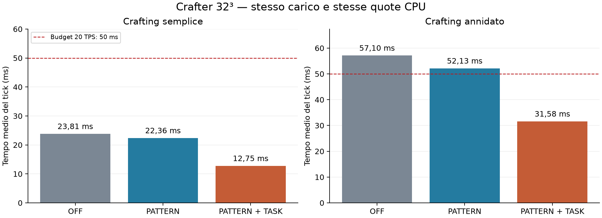
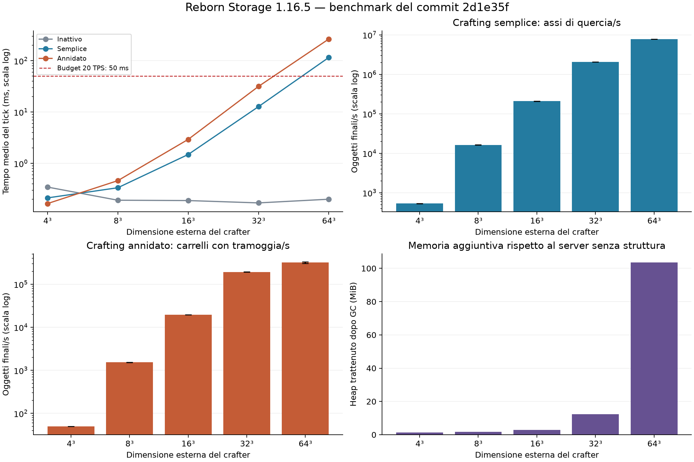

# Esperimento crafting: due strade nel port

Branch **`experiment/crafting-engine-1.16.5`**, implementazione `2d1e35f`, base stabile `00928a2`. **Nessun merge eseguito: richiede l’autorizzazione dell’utente.** [Metodo e riproduzione](METHOD.md), [architettura e limiti](../../EXPERIMENT-CRAFTING-ENGINE.md).

Il prototipo mantiene quote delle CPU, quantità e notifiche per craft. Il miglioramento viene dalla riduzione del lavoro ripetuto. Le dipendenze RS sono invariate; l’esecuzione dedicata è registrata dal port e dipende dalle strutture interne di RS 1.9.17.

## Confronto controllato sul 32³

OFF è il riferimento originale. PATTERN riusa l’inventario temporaneo delle ricette vanilla ammesse. TASK include PATTERN e aggiunge la preparazione dei requisiti a variante fissa e la verifica degli ingredienti senza copie degli stack. Questo misura il contributo incrementale della seconda strada, non TASK isolato da PATTERN.

| Modalità | Semplice ms/tick | Annidato ms/tick | TPS annidato | Carrelli con tramoggia/s |
| --- | ---: | ---: | ---: | ---: |
| OFF | 23,81 | 57,10 | 17,43 | 167.981 |
| PATTERN | 22,36 | 52,13 | 19,13 | 184.319 |
| PATTERN + TASK | 12,75 | 31,58 | 20,00 | 192.705 |

La prima strada riduce il tempo del tick del **6,1%** nel semplice e del **8,7%** nell’annidato. Le due insieme arrivano al **46,4%** e **44,7%**. Il 32³ annidato torna a 20 TPS.

Nei 720 tick di ciascun carico sul 32³ tutte e tre le modalità producono esattamente 73.977.260 assi e 6.938.743 carrelli. Anche il 64³ produce le stesse quantità della 0.1.2: 653.015.980 assi e 61.250.039 carrelli. Le quote di lavoro non sono state ridotte.

Le tre finestre consecutive per modalità sono complete. Sono JVM distinte per modalità, non tre avvii indipendenti ciascuna. Le piccole differenze di throughput semplice a 20 TPS sono rumore; la riduzione del costo del tick è molto più ampia.



## Taglie piccole e 64³ con esecutore dedicato

| Struttura | Semplice ms/tick | TPS semplice | Annidato ms/tick | TPS annidato | Carrelli/s |
| --- | ---: | ---: | ---: | ---: | ---: |
| 4³ | 0,21 | 20,00 | 0,16 | 20,00 | 50 |
| 8³ | 0,34 | 20,00 | 0,46 | 20,00 | 1.535 |
| 16³ | 1,49 | 20,00 | 2,93 | 20,00 | 19.583 |
| 32³ | 12,75 | 20,01 | 31,58 | 20,00 | 192.705 |
| 64³ | 115,85 | 8,64 | 265,12 | 3,76 | 319.947 |

Nel 64³ il semplice passa da 216,86 a **115,85 ms/tick** e l’annidato da 520,70 a **265,12 ms/tick**. Il confronto del 64³ usa la [campagna 0.1.2 precedente](../2026-11-18-full-0.1.2/README.md), sullo stesso computer e con lo stesso carico; non è un nuovo A/B completo del 64³.

La produzione annidata del 64³ è **1,96 volte** quella precedente. Il server resta però a **3,76 TPS**: il prototipo riduce il costo del ciclo per craft, ma non rende questa configurazione sostenibile a 20 TPS. Non introduce batching né un limite temporale condiviso.



## Correttezza e artefatto

- Entrambe le modalità superano la suite server su due avvii, con un ordine salvato e ripreso dopo il vero riavvio. Ogni avvio comprende 114 controlli differenziali aggiuntivi, oltre a quelli preesistenti.
- Coperti NBT, varianti multiple con fallback, quantità di output e ingredienti, secchi residui delle torte, ricette dinamiche, quote e callback, stato parziale e inserimenti accettati solo in parte o rifiutati.
- Le tre schermate wireless e le due pagine del crafter si aprono nel client; i dettagli del controllo visivo e i limiti sono nel metodo.
- Il JAR reobfuscato parte su Forge dedicato con le dipendenze di produzione e completa esattamente l’ordine da 4.000 assi lasciato dal test, poi si arresta correttamente.
- **42 finestre di crafting complete, 10.080 tick attivi** nella campagna accettata. La prima prova OFF con il processo di controllo interrotto è esclusa.
- Il modpack completo, i carichi misti con macchine di processing, il multiplayer prolungato e tutte le ricette moddate non sono stati verificati in questa campagna.

JAR: `build/libs/rebornstorage-1.16.5-0.1.3-experimental.1.jar`. SHA256:

```text
5df91f056af5ff9a8dc54b9766631eb8b1b2f4e70d7781ee87e17aa5a10a4bfc
```

La modalità predefinita è OFF. Per provare il percorso completo impostare `general.experimental_crafting = "TASK"` e riavviare il server. Gli ordini sperimentali salvati richiedono che la factory resti disponibile: prima di rimuovere questo JAR bisogna farli terminare.

## Dati

- [Confronto CSV](comparison.csv), [verifiche delle finestre](verification.json), [validazione e JAR](validation.json).
- OFF32: [riepilogo](off/summary.json), [raw](off/raw-32.json).
- PATTERN32: [riepilogo](pattern/summary.json), [raw](pattern/raw-32.json).
- TASK: [riepilogo](task/summary.json), [finestre](task/rounds.csv), [4³](task/raw-4.json), [8³](task/raw-8.json), [16³](task/raw-16.json), [32³](task/raw-32.json), [64³](task/raw-64.json).
- Metadati host e processo nelle rispettive sottocartelle; log e mondi completi restano sotto `run/`.
