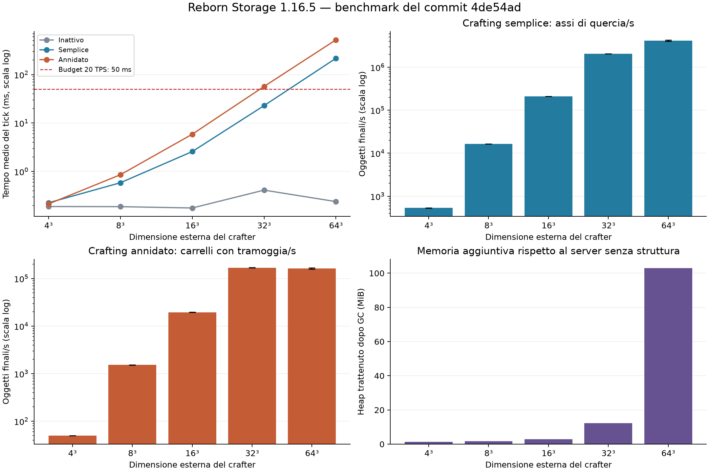

# Campagna completa 0.1.2 — fino al 64³

Ripetizione su **Reborn Storage 1.16.5-0.1.2**, incluso per la prima volta il **64³** richiesto dall’utente. Codice di produzione invariato durante le prove. [Metodo e comandi](METHOD.md).

**Tutti e cinque i casi terminati:** 30 finestre di crafting, ciascuna con 240 tick e output positivo. Totale 7.200 tick attivi, oltre a baseline, inattività e riscaldamento. Un server nuovo per dimensione, tre finestre consecutive per carico.

## Tempi del tick e TPS

Tempo medio del tick completo del server. Il budget per mantenere 20 TPS è 50 ms. Nessuna schermata aperta e nessun profiler; un ordine alla volta.

| Crafter | CPU | Inattivo ms | Semplice ms | TPS semplice | Annidato ms | P95 annidato ms | TPS annidato |
| --- | ---: | ---: | ---: | ---: | ---: | ---: | ---: |
| 4³ | 7 | 0,19 | 0,23 | 20,00 | 0,21 | 0,38 | 20,00 |
| 8³ | 215 | 0,19 | 0,59 | 20,00 | 0,86 | 1,22 | 20,00 |
| 16³ | 2.743 | 0,18 | 2,57 | 20,00 | 5,87 | 9,37 | 20,00 |
| 32³ | 26.999 | 0,41 | 22,87 | 20,01 | 56,88 | 92,79 | 17,48 |
| 64³ | 238.327 | 0,24 | 216,86 | 4,61 | 520,70 | 840,32 | 1,92 |

## Throughput, memoria e collegamento

Assi = ricetta semplice. Carrelli con tramoggia = ricetta annidata con cinque pattern/sei esecuzioni per oggetto finale. Heap aggiuntivo = differenza dopo GC rispetto al server senza struttura; RSS = memoria residente totale del processo.

| Crafter | Assi/s | Carrelli/s | Heap aggiuntivo MiB | Picco RSS MiB | Collegamento RS ms |
| --- | ---: | ---: | ---: | ---: | ---: |
| 4³ | 533 | 50 | 1,43 | 2.715,41 | 16,27 |
| 8³ | 16.367 | 1.535 | 1,68 | 2.722,02 | 18,79 |
| 16³ | 208.805 | 19.583 | 2,84 | 2.722,80 | 13,25 |
| 32³ | 2.056.464 | 168.488 | 12,18 | 2.755,24 | 28,56 |
| 64³ | 4.184.817 | 162.925 | 103,04 | 2.817,05 | 29,14 |

La rete contiene **3 nodi complessivi per tutte le dimensioni**: controller, disk drive e provider aggregato. Il multiblocco resta fisicamente pieno. I tempi di collegamento escludono posizionamento e assemblaggio, riportati separatamente nei raw e nel riepilogo.

## Cosa mostra il 64³

Sul Core Ultra 9 275HX della prova, fino al 16³ entrambi i carichi mantengono 20 TPS. Il 32³ supera già il budget di 50 ms nel crafting annidato. Il 64³ completa il lavoro, ma a 4,61 TPS nel semplice e 1,92 TPS nell’annidato rallenta gravemente la simulazione del server.

Rispetto al 32³, il 64³ produce **2,03 volte le assi al secondo**, spendendo **9,48 volte il tempo per tick**. Nel crafting annidato produce invece il **3,3% in meno**, con **9,15 volte il tempo per tick**. La differenza di throughput va letta nel contesto di una sola JVM per dimensione; il punto solido è che aggiungere CPU non aumenta proporzionalmente il lavoro per secondo reale quando i TPS crollano.

Le tre finestre annidate del 64³ misurano 504,73 / 537,37 / 519,99 ms per tick, durando 121,28 / 129,58 / 125,08 secondi reali. Il P95 aggregato è 840,32 ms; il tick peggiore dura 982,10 ms. I timeout maggiorati hanno consentito di raccogliere tutte le finestre intere.

I contatori indicano saturazione di elaborazione del thread server: circa **517 ms di CPU del thread per tick**, a fronte di 521 ms di durata media del tick. Il processo usa circa 1,06 core equivalenti; la garbage collection occupa lo **0,73%** del tempo annidato e lo **0,67%** del semplice. Questi contatori non sono un nuovo profilo degli stack: l’attribuzione dettagliata alle funzioni di RS rimane quella della [precedente indagine sul 32³](../../investigations/2026-11-18-mspt/README.md).

La struttura inattiva costa poco: 0,24 ms/tick totali, circa 103 MiB aggiuntivi di heap trattenuto dopo GC e 2,75 GiB di picco RSS dell’intero processo. Anche il collegamento RS resta rapido (29 ms). Il posizionamento in blocco richiede 0,69 s, l’assemblaggio 3,24 s e il salvataggio esplicito finale 7,11 s; questi tempi sono separati dalle misure di crafting.

## Confronto con 0.1.1

Stesso carico e capacità energetica per 4–32³. Queste prove senza UI non misurano il beneficio dell’accorpamento dei pacchetti del monitor; la misura dedicata è [qui](../2026-11-18-local-opt/README.md). Differenze piccole fra JVM/sessioni includono rumore e JIT, non dimostrano da sole un miglioramento o peggioramento del port.

| Crafter | Semplice ms, 0.1.1 → 0.1.2 | Annidato ms, 0.1.1 → 0.1.2 | TPS annidato, 0.1.1 → 0.1.2 |
| --- | ---: | ---: | ---: |
| 4³ | 0,28 → 0,23 | 0,32 → 0,21 | 20,00 → 20,00 |
| 8³ | 0,43 → 0,59 | 0,68 → 0,86 | 20,00 → 20,00 |
| 16³ | 2,60 → 2,57 | 5,73 → 5,87 | 20,00 → 20,00 |
| 32³ | 23,89 → 22,87 | 58,65 → 56,88 | 16,98 → 17,48 |

Il 64³ non ha un precedente misurato: i suoi risultati sono diretti, non estrapolati.

## Energia e limiti

| Crafter | FE/t rilevati | Buffer controller FE |
| --- | ---: | ---: |
| 4³ | 46 | 32.000 |
| 8³ | 1.086 | 32.000 |
| 16³ | 13.726 | 32.000 |
| 32³ | 135.006 | 2.000.000 |
| 64³ | 1.191.646 | 2.000.000 |

Le capacità maggiorate e il limite strutturale di 64 blocchi sono usati solo nei mondi isolati. Non sono stati modificati il pack Prism, la velocità del crafter o RS. Il 64³ usa timeout di fase più lunghi per completare davvero 240 tick anche quando il server non mantiene 20 TPS.

Il modpack completo, molte ricette, ordini simultanei, interfacce aperte e macchine di processing possono aggiungere altri costi. Questi risultati non garantiscono gli stessi TPS in un mondo di gioco reale.

## Artefatti

- [Riepilogo CSV](summary.csv), [JSON](summary.json), [singole finestre](rounds.csv), [confronto 0.1.1/0.1.2](comparison.csv).
- Raw: [4³](raw-4.json), [8³](raw-8.json), [16³](raw-16.json), [32³](raw-32.json), [64³](raw-64.json).
- [Verifiche completezza e SHA256 JAR](verification.json).
- Host: [4–16](host.json), [32](host-size-32.json), [64](host-size-64.json).
- [Figura PNG](performance.png), [SVG](performance.svg). I mondi e i log completi rimangono in `run/benchmarks/`.
