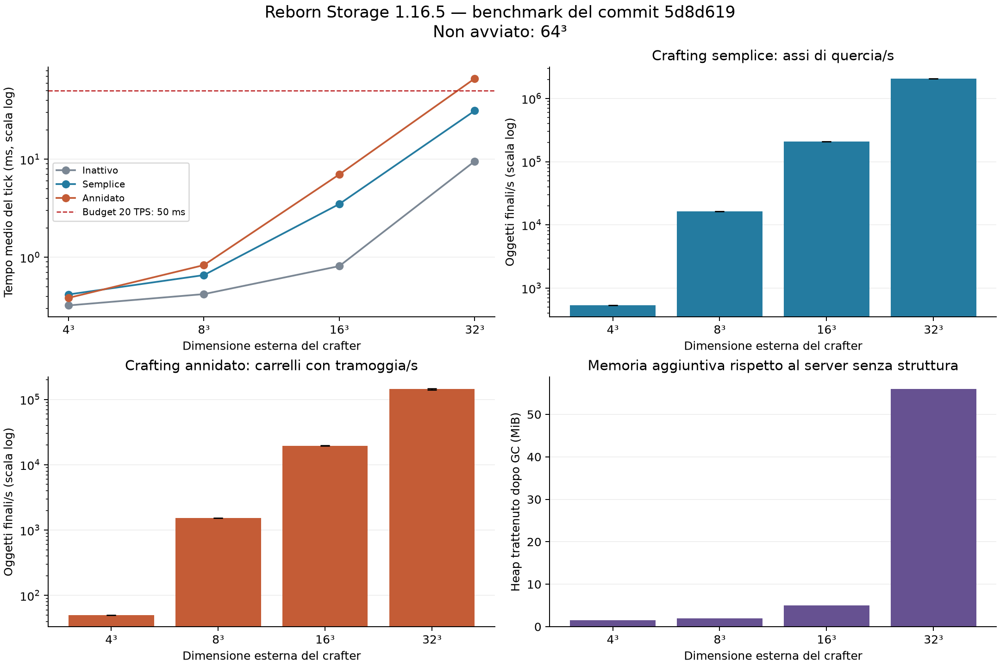

# Benchmark Reborn Storage 1.16.5 — 18 novembre 2026

Codice misurato: **`5d8d619`**, senza modifiche di produzione. Intel Core Ultra 9 275HX, Java 8, Forge 36.2.26 e RS 1.9.17; server dedicato isolato con dipendenze mirate, non il modpack completo. Tre finestre consecutive per ogni carico, un mondo nuovo per ogni dimensione. [Metodo completo](METHOD.md).

**Il 64³ non è stato avviato, su richiesta dell’utente.** Il 32³ viene riportato con buffer RS adeguato (2.000.000 FE); il primo tentativo con buffer predefinito era privo di energia sufficiente ed è conservato separatamente.

## Tempi del server e TPS

MSPT = millisecondi per tick dell’intero server di prova, compreso l’harness. Il budget per 20 TPS è 50 ms. P95 indica il tempo entro cui termina il 95% dei tick campionati. I TPS sono osservati durante i carichi, non dedotti dalla media.

| Dimensione | CPU | Baseline ms | Inattivo ms | Semplice ms / P95 | Annidato ms / P95 | TPS semplice / annidato |
| --- | ---: | ---: | ---: | ---: | ---: | ---: |
| 4³ | 7 | 0,31 | 0,32 | 0,42 / 0,57 | 0,39 / 0,52 | 20,00 / 20,00 |
| 8³ | 215 | 0,29 | 0,42 | 0,66 / 0,85 | 0,83 / 1,23 | 20,00 / 20,00 |
| 16³ | 2.743 | 0,19 | 0,81 | 3,50 / 4,25 | 7,01 / 10,86 | 20,00 / 20,00 |
| 32³ | 26.999 | 0,24 | 9,56 | 31,29 / 38,77 | 66,68 / 104,15 | 20,02 / 14,94 |

## Throughput effettivo

Il carico semplice trasforma tronchi in assi. Quello annidato produce carrelli con tramoggia da tronchi e ferro, passando per assi, casse, tramogge e carrelli: cinque pattern, quattro livelli, sei esecuzioni di ricetta per oggetto finale. Gli intervalli sono minimo e massimo delle tre finestre, **non intervalli di confidenza**.

| Dimensione | Assi/s, media | Min–max | Carrelli con tramoggia/s, media | Min–max |
| --- | ---: | ---: | ---: | ---: |
| 4³ | 533 | 532–534 | 50 | 50–50 |
| 8³ | 16.366 | 16.340–16.414 | 1.535 | 1.523–1.541 |
| 16³ | 208.813 | 208.484–209.405 | 19.582 | 19.422–19.665 |
| 32³ | 2.056.739 | 2.052.116–2.061.826 | 144.009 | 141.074–147.091 |

## Avvio, memoria ed energia

| Dimensione | Posizionamento s | Assemblaggio s | Connessione RS s | Heap aggiuntivo MiB | RSS massimo GiB | FE/t calcolati |
| --- | ---: | ---: | ---: | ---: | ---: | ---: |
| 4³ | 0,006 | 0,047 | 0,042 | 1,53 | 2,66 | 46 |
| 8³ | 0,015 | 0,042 | 0,207 | 1,93 | 2,65 | 1.086 |
| 16³ | 0,057 | 0,065 | 4,686 | 5,00 | 2,67 | 13.726 |
| 32³ | 0,187 | 0,263 | 403,650 | 55,97 | 2,71 | 135.006 |

L’heap aggiuntivo è la differenza dopo GC rispetto alla baseline dello stesso processo; non è la RAM totale richiesta dalla mod. RSS comprende l’intera JVM, anche durante l’avvio. Gli avvii non sono stati replicati tre volte: la singola misura di connessione va distinta dalle tre finestre di crafting.

## Interpretazione

- Fino al 16³, entrambi i carichi mantengono circa 20 TPS in questo ambiente. Il carico annidato costa più tempo per tick rispetto al semplice.
- Il 32³ evidenzia un grave costo di collegamento: oltre sei minuti sul thread server. Posizionamento e assemblaggio della struttura richiedono invece frazioni di secondo.
- Una volta collegato, il 32³ mantiene circa 20 TPS nel crafting semplice, ma scende a **14,94 TPS nel nested crafting**: 66,68 ms medi e P95 104,15 ms. È un secondo collo di bottiglia, distinto dall'avvio; correggere soltanto la connessione non garantisce 20 TPS sotto quel carico.
- I due avvii 32³, con buffer diversi, richiedono rispettivamente 368,94 s e 403,65 s per la connessione. Entrambi mostrano ricostruzioni ripetute della lista dei container; non è una misura controllata dell’effetto della capacità sul tempo di avvio.
- Con buffer predefinito 32.000 FE, il 32³ richiede 135.006 FE/t e spegne la rete anche con controller creativo. Quel tentativo ha prodotto zero oggetti; i suoi tempi non descrivono crafting operativo.
- La correzione prioritaria è nel port: raggruppare le invalidazioni globali dei pattern. I costi di visita/ordinamento e di esecuzione per singolo craft sono invece interni a RS, amplificati da come esponiamo ogni blocco del multiblocco.
- Nessun risultato del 64³ è stimato o estrapolato. Non sono misurati migliaia di pattern, molti ordini contemporanei, rendering client, monitor aperti, macchine esterne o un mondo Cuboid completo.

La [diagnosi completa e i vettori di risoluzione](ANALYSIS.md) distinguono responsabilità del port, limiti RS, configurazione e complessità degli interventi. Nessuna ottimizzazione è stata applicata durante queste misure.

## Artefatti

- [Riepilogo CSV](summary.csv), [JSON](summary.json) e [singole finestre](rounds.csv).
- Raw JSON: [4³](raw-4.json), [8³](raw-8.json), [16³](raw-16.json), [32³](raw-32.json).
- [Hardware e campagna iniziale](host.json), [ripetizione 32³](host-size-32.json), `process-N.json` con RSS/carico host/esito del processo.
- [Primo 32³ con buffer insufficiente](diagnostic-default-buffer/summary.json), [transizioni della rete](diagnostic-default-buffer/transitions.log), [stack del thread server](connection-stacks.txt).
- [Grafico PNG](performance.png), [SVG](performance.svg), [esclusione del 64³](skipped-64.json).
- Harness: `src/benchmark/java/net/gigabit101/rebornstorage/PortBenchmark.java`; runner e analizzatore in `scripts/`. I source set di benchmark non entrano nel JAR pubblicato.
