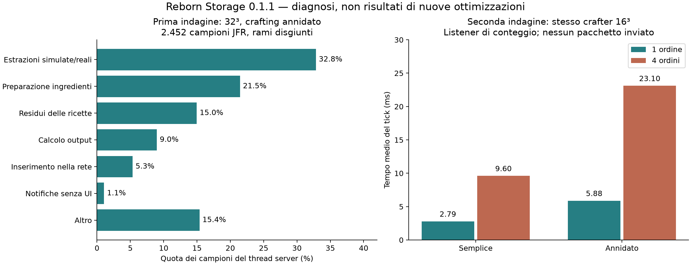

# Due indagini sui ms/tick — Reborn Storage 0.1.1

**Esito:** il costo stabile del 32³ è dominato dal percorso di crafting RS;
la seconda passata trova due aree che il profilo senza giocatori e con un solo
storage non poteva mostrare: le notifiche delle interfacce e il rebuild delle
pagine. La concorrenza degli ordini moltiplica il lavoro anche con un solo
provider. Le due indagini sono dello stesso autore, non due review indipendenti.

- [Indagine 1: profilo CPU, allocazioni e motore di crafting](INVESTIGATION-1.md).
- [Indagine 2: verifica delle omissioni, UI, concorrenza, pagine e rischi](INVESTIGATION-2.md).

Nessun cambiamento ai sorgenti di produzione o al JAR distribuito. Sono stati
aggiunti strumenti diagnostici e due opzioni di workload al benchmark. I tre
server isolati sono terminati correttamente; 18 finestre attive da 240 tick,
sempre con output positivo. Nessun 64³, nessuna modifica al modpack Prism.



## Ordine di implementazione proposto

| Priorità | Intervento concreto | Ambito | Criterio di successo |
| --- | --- | --- | --- |
| 1 | Accorpare notifiche del Super Wireless Monitor a fine tick | Port, container dedicato; copertura di monitor/griglie altrui richiede percorso comune RS | Stato iniziale/finale corretto, al massimo un invio di stato per tick per viewer, nessun cambio al throughput |
| 2 | Iterazione diretta delle pagine e cache dei pattern per slot; separare aggiornamento FE e pattern | Port | Ricerca slot lineare nel totale degli slot, rebuild dei soli slot sporchi, corretta invalidazione su reload/struttura, pattern e task salvati integri |
| 3 | Eliminare liste/copie inutili nella gestione ingredienti e simulazione | RS o esecutore dedicato tramite API | Meno allocazioni e ms a parità di ricette, quantità e output, con ripristino/cancellazione verificati |
| 4 | Riusare strutture temporanee per output/residui mantenendo la semantica delle ricette | Adattatore pattern/RS | Nessuna cache universale di ricette arbitrarie; test NBT, capability, contenitori e reload |
| 5 | Batching di craft e inserimenti compatibili | Motore RS o factory task dedicata | Riduzione delle operazioni a parità di lavoro, nessuna perdita/duplicazione con storage pieno, rete spenta o riavvio |
| Separata | Quota condivisa e fairness | Scheduler/integrazione | Protegge TPS senza starvation; cambiamento di politica dichiarato, non presentato come guadagno gratuito |

I punti 1–2 non promettono di ridurre i circa 58 ms/tick del 32³ senza UI e
con un solo storage: correggono scenari esclusi da quel profilo. Per ridurre quel
costo stabile, i bersagli misurati sono i punti 3–5.

I punti 3–5 si sovrappongono: partire da un prototipo misurabile, non introdurre
contemporaneamente più motori/patch che fanno lo stesso lavoro. Una modifica
mirata a RS riduce il codice da riscrivere ma lega a una versione; una factory
nel port evita di sostituire il JAR RS ma richiede molto più codice e attenzione
alle reti miste. Il profilo non giustifica ancora una scelta definitiva tra le due.

La prima verifica implementativa deve confrontare lo stesso carico su JVM nuove,
con e senza UI. Poi ampliare a molte ricette uniche, NBT/tag, external storage,
processing con macchine, task simultanei, chunk realmente scaricati, reload,
riavvio e modpack completo. Nessuna percentuale del profiler è una promessa di
riduzione dei ms/tick dopo una patch.

## Riproduzione e artefatti

JDK 17 per Gradle e gli strumenti di lettura JFR; Minecraft resta su Java 8.

```sh
JAVA_HOME=/usr/lib/jvm/java-17-openjdk python scripts/benchmark_port.py --sizes 32 --controller-capacity 2000000 --jfr --tag investigation1-jfr32
JAVA_HOME=/usr/lib/jvm/java-17-openjdk python scripts/benchmark_port.py --sizes 16 --property bench.countListeners=true --tag investigation2-one
JAVA_HOME=/usr/lib/jvm/java-17-openjdk python scripts/benchmark_port.py --sizes 16 --property bench.countListeners=true --property bench.concurrent=4 --tag investigation2-four
/usr/lib/jvm/java-17-openjdk/bin/java scripts/ExportCrafterJfr.java run/benchmarks/investigation1-jfr32/size-32/profile.jfr > events.json
python scripts/analyze_crafter_jfr.py events.json run/benchmarks/investigation1-jfr32/size-32/phase-timeline.jsonl summary.json
```

I tag devono essere nuovi per ripetere le campagne. L'export compatto è stato
confrontato con quello standard `jfr print`: conteggi, classificazione dei rami
e somme TLAB coincidono. I sorgenti di analisi sono fuori dai source set della
mod. Non sono stati aggiunti profiler o mod al pacchetto del giocatore.

- [Misure aggregate](measurements.json), [campioni JFR](jfr-summary.json).
- Raw: [32³ profilato](profiled-32.json), [16³ un ordine](one-order-16.json),
  [16³ quattro ordini](four-orders-16.json), con timeline separate.
- [Provenienza, configurazione e hash degli artefatti locali](provenance.json).
- Il JFR integrale e i log restano in `run/benchmarks/`; non sono pubblicati.
- L'analisi dell'export iniziale è terminata prima delle misure attive del 16³.
  Le JVM Minecraft sono state eseguite in sequenza. La normale sessione desktop
  era attiva: questi test non eliminano il rumore dell'host.
